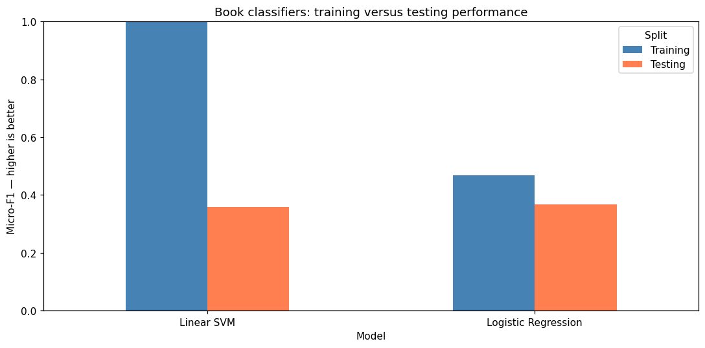

# Book Mood Reader

**Exploring the connection between books, music and emotion through multi-label classification.**


Book Mood Reader is a student AI project by **Tihomira Miteva**. It explores whether a book description can be used to predict emotions and connect a story with music that has a similar atmosphere. It is intended for people who enjoy listening to music while reading.

The repository includes the final notebook, two small self-collected datasets, model comparisons, evaluation results, a local Streamlit demo and the supporting project documents.

## Start here

- [Final notebook, with code, explanations and outputs](notebooks/Book_Mood_Reader.ipynb)
- [Read-only notebook report](reports/Book_Mood_Reader.html)
- [Demo setup and walkthrough](docs/demo.md)
- [Project proposal](docs/reports/project_proposal.pdf)
- [Data collection report](docs/reports/data_collection_report.pdf)
- [Project architecture](docs/images/architecture.png)
- [Final presentation](docs/presentation/Book_Mood_Reader.pptx)
- [Reflection and next steps](docs/reflection.md)

## Research question

**Can a book description help us find songs with a similar emotional mood?**

The idea is to explore a soundtrack for a book's atmosphere, rather than recommend music using genre alone. The emotional suitability of the playlists has not yet been evaluated with listeners.

## Data

| Dataset | Records | Inputs | Classification targets |
| --- | ---: | --- | --- |
| Books | 15 | Reader-provided descriptions; title, author and genre retained for context | 25 emotion ratings: **4–5 = strongly present**, **1–3 = not strongly present** |
| Songs | 80 | Four numerical audio features, plus title, artist and local audio reference | Selected emotion labels from the same 25-label vocabulary |

Book information was collected through a questionnaire. The music collection was researched and assembled personally, including songs associated with book playlists. AI assistance was used for some cleaning and provisional song emotion suggestions; the song labels are not independently reviewed ground truth.

Original book ratings remain available for EDA. A low book target means an emotion is **not strong**, rather than absent. An unselected song label likewise does not prove emotional absence.

**Audio recordings are not included in GitHub.** Song metadata and the extracted feature cache are included. The notebook and text-to-playlist demo can run using this cache. Playback and extracting features from the original recordings require local audio. See [data provenance and audio setup](data/README.md).

## Modeling approach

Both pipelines use **multi-label classification** because an item can have several emotions.

| Pipeline | Feature preparation | Models compared |
| --- | --- | --- |
| Books | TF-IDF, fitted on training descriptions | One-vs-Rest Logistic Regression; One-vs-Rest Linear SVM |
| Songs | Librosa: tempo, RMS energy, spectral centroid and zero-crossing rate; training-fitted standardization | One-vs-Rest Logistic Regression; Random Forest |

Audio measurements summarize a **30-second excerpt starting at second 20**, converted to mono at 22,050 Hz. Sentence embeddings were discussed during planning but are not implemented in this iteration.

The requested split is approximately **70% training / 10% validation / 20% testing**, with random seed 42:

| Dataset | Training | Validation | Testing |
| --- | ---: | ---: | ---: |
| Books | 10 | 2 | 3 |
| Songs | 56 | 8 | 16 |

Validation **micro F1** selects the classifier. Logistic Regression was retained for books after a validation tie, and selected for songs. The test set is used after model selection. See [methodology](docs/methodology.md) for preprocessing, metrics and matching.

## Recorded results

| Selected model | Test precision (micro) | Test recall (micro) | Test micro F1 | Test exact-match accuracy |
| --- | ---: | ---: | ---: | ---: |
| Books: Logistic Regression | 0.778 | 0.241 | **0.368** | 0% |
| Songs: Logistic Regression | 0.636 | 0.350 | **0.452** | 0% |

Micro F1 balances precision and recall across emotion decisions; it is **not an accuracy percentage**. Exact-match accuracy requires the entire label set to be correct, so 0% does not mean every individual emotion prediction was wrong.

The Linear SVM book model reached training F1 **1.00** but test F1 **0.359**. The song Random Forest dropped from **0.828** to **0.407**. These gaps are consistent with overfitting. The results are modest and particularly uncertain for the three-book test set.



Full results and charts are in [results/tables](results/tables) and [results/figures](results/figures).

## Run locally

Use **Python 3.12**. Run these commands from the repository root:

```powershell
python -m venv .venv
.venv\Scripts\python.exe -m pip install -r requirements.txt
.venv\Scripts\python.exe -m jupyter lab notebooks/Book_Mood_Reader.ipynb
```

Choose the virtual environment's kernel and run the notebook from top to bottom. It supports working directories at the repository root or inside `notebooks/`. When recordings are missing, it uses the supplied feature cache and explicitly reports that audio quality cannot be revalidated.

For the demo:

```powershell
.venv\Scripts\python.exe -m streamlit run app/demo_app.py
```

Alternatively, double-click `RUN_DEMO.bat` after installing the dependencies. The app opens at **http://127.0.0.1:8501** while the server is running. On macOS/Linux, use `.venv/bin/python` instead of `.venv\Scripts\python.exe`.

### What the demo currently does

The book classifier predicts moods from the entered text. The song classifier predicts moods from cached audio features. The interface displays a **fixed presentation playlist** with match scores calculated for the current description; the playlist and its order do not change with the input. This behavior is intentional in the current presentation version.

The **notebook** separately demonstrates ranking the song library using predicted moods. The demo's scores are ranking measurements, not probabilities of liking a song. Neither version has an independent listener evaluation. The song tab can analyze an uploaded recording; library playback requires local audio.

## Repository structure

```text
Book-mood-reader/
├── README.md
├── requirements.txt
├── RUN_DEMO.bat
├── app/                       # Streamlit interface and inference helpers
├── notebooks/                 # Final, executed project notebook
├── data/
│   ├── raw/                   # Book ratings and song annotation table
│   ├── audio/                 # Local-only recordings, ignored by Git
│   ├── books_clean.csv
│   ├── songs_clean.csv
│   └── simple_audio_features.csv
├── models/                    # Selected classifiers and preprocessing
├── results/
│   ├── figures/               # EDA and evaluation graphs
│   └── tables/                # Metrics, splits and recorded summaries
├── reports/                   # Read-only HTML notebook
└── docs/
    ├── reports/               # Original proposal and data collection PDFs
    ├── images/                # Architecture, cover and demo preview
    ├── presentation/          # Final slide deck
    ├── methodology.md
    ├── demo.md
    └── reflection.md
```

## Potential, limitations and next steps

The project demonstrates a complete workflow and has potential for further development. A short collection period limited the amount and variety of data. The small samples, uneven emotions, subjective annotations and simple audio features restrict generalization and matching quality.

The next iteration needs **substantially more varied books and songs**, better coverage of rare emotions and reviewed labels. Further evaluation should use more unseen examples and listener feedback to check whether playlists actually fit a book. More data alone does not guarantee better results; annotation quality, features and evaluation also matter. See the [full reflection](docs/reflection.md).

## Supporting documents and attribution

The proposal, collection report and architecture are original planning materials. They describe intended work, including ideas that changed during implementation. The final notebook and the behavior documented above describe this iteration: book ratings use a threshold of 4, and song labels include AI-assisted suggestions.

Python libraries include scikit-learn, pandas, NumPy, Librosa, Matplotlib, Seaborn, Jupyter and Streamlit. The cover is an AI-generated illustrative image. Song metadata refers to the respective artists' work; recordings are excluded from this repository. No project-wide reuse license has been selected.
